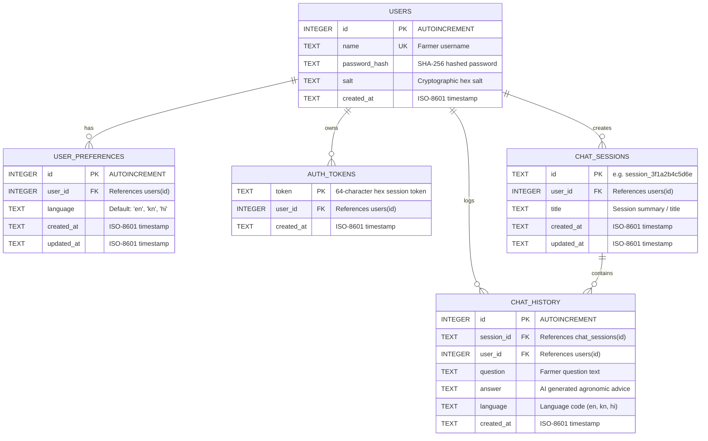

# AgriAI — Offline AI Farming Intelligence Platform

[](https://react.dev/)
[](https://fastapi.tiangolo.com/)
[](https://tensorflow.org/)
[](https://scikit-learn.org/)
[](https://www.sqlite.org/)
[-4A154B)](https://lmstudio.ai/)

**AgriAI** is an offline-capable, local-first artificial intelligence platform designed to empower farmers and agricultural professionals with instant scientific crop guidance, deep learning leaf disease diagnosis, localized conversational farming assistance, real-time meteorological intelligence, and multi-lingual accessibility (English, Kannada, Hindi) — completely preserving user privacy and operational reliability even in remote rural settings with intermittent connectivity.

---

## 📑 Table of Contents

1. [Project Overview & Problem Statement](#-project-overview--problem-statement)
2. [System Architecture](#-system-architecture)
3. [Implemented Core Features](#-implemented-core-features)
4. [Technology Stack](#-technology-stack)
5. [Repository Directory Structure](#-repository-directory-structure)
6. [Artificial Intelligence & Machine Learning Pipeline](#-artificial-intelligence--machine-learning-pipeline)
7. [Database Architecture & Schema](#-database-architecture--schema)
8. [Backend REST API Reference](#-backend-rest-api-reference)
9. [Internationalization & Multi-Language System (i18n)](#-internationalization--multi-language-system-i18n)
10. [Prerequisites & Installation Guide](#-prerequisites--installation-guide)
11. [Running the Application Locally](#-running-the-application-locally)
12. [Troubleshooting & FAQ](#-troubleshooting--faq)
13. [Future Roadmap vs. Implemented Status](#-future-roadmap-vs-implemented-status)

---

## 🌾 Project Overview & Problem Statement

### The Problem
Modern farmers face critical agronomic hurdles, including unpredictable climate variations, nutrient deficiencies, plant diseases, and lack of timely expert advice. Conventional digital farming solutions often require uninterrupted high-speed internet, subscription models, or external cloud dependencies that are inaccessible in remote rural agricultural zones.

### The Solution: AgriAI
AgriAI provides an all-in-one local intelligence agricultural dashboard:
- **Offline LLM Farming Assistant**: Runs entirely on a local Large Language Model (`phi-3-mini-4k-instruct` via LM Studio) to answer agronomic queries in natural language without data leakage or cloud costs.
- **Scientific Crop Recommendation**: Uses a trained Scikit-Learn machine learning classifier to evaluate soil chemistry (Nitrogen, Phosphorus, Potassium, pH) and micro-climate conditions (Temperature, Humidity, Rainfall) to predict optimal crops with probability confidence scores.
- **Computer Vision Leaf Disease Diagnosis**: Employs a custom Convolutional Neural Network built on MobileNetV2 transfer learning (`leaf_disease_model.keras` / `leaf_disease.weights.h5`) to identify 15 specific plant pathologies across tomato, potato, and bell pepper crops in milliseconds.
- **Real-Time Local Meteorological Intelligence**: Queries the Open-Meteo forecast engine and reverse-geocodes coordinates to display live temperature, feels-like metrics, humidity, wind velocity, precipitation probability, and daily extremes inside a responsive glassmorphic card.
- **Privacy-First Local Authentication & History**: Houses user profiles, preferences, and multi-session conversational chat logs inside a local SQLite database (`backend/data/agriai.db`) using salted SHA-256 password hashing.
- **Multilingual Support**: Fully localized interface across English, Kannada (ಕನ್ನಡ), and Hindi (हिंदी).

---

## 🏛 System Architecture

The following diagram illustrates the end-to-end data flow between the user interface, backend microservices, local AI/ML inference engines, database persistence, and external weather services:

```mermaid
flowchart TD
    User([👨‍🌾 Farmer / User])
    
    subgraph Frontend["🖥️ Frontend Application (React 19 + Vite @ :3000)"]
        UI[App.jsx Application Shell]
        Nav[DashboardNavbar & LandingNavbar]
        Lang[i18n Multi-Language Provider: EN / KN / HI]
        Voice[Web Speech API: Voice-to-Text]
        Geo[HTML5 Geolocation: Coordinates]
        ChatComp[ChatAssistant & ChatHistory]
        CropComp[CropRecommendation Module]
        LeafComp[LeafHealth Vision Module]
        WeatherComp[WeatherCard Glassmorphism Component]
    end

    subgraph Backend["⚙️ Backend Service (FastAPI @ :8000)"]
        Router[FastAPI Request Router & Auth Dependency]
        CORS[CORS Middleware]
        DB_Engine[SQLite DB Engine: db.py]
        
        EP_Auth["/auth/register, /auth/login, /auth/profile"]
        EP_Chat["/chat, /chat/history, /chat/new"]
        EP_Crop["/crop-recommendation"]
        EP_Leaf["/leaf-disease"]
        EP_Weather["/weather"]
    end

    subgraph LocalAI["🧠 Local AI & Machine Learning Engines"]
        LMStudio["LM Studio Server (127.0.0.1:1234)<br/>Model: phi-3-mini-4k-instruct"]
        CropModel["Crop Recommendation Classifier<br/>(crop_recommendation_model.pkl)"]
        LeafModel["MobileNetV2 Deep Learning Vision Model<br/>(leaf_disease_model.keras)"]
    end

    subgraph Storage["💾 Persistent Local Storage"]
        SQLiteDB[(agriai.db SQLite Database<br/>Users, Preferences, Tokens, Chat Sessions)]
    end

    subgraph ExternalServices["🌐 External Public APIs (Online Mode)"]
        OpenMeteo["Open-Meteo Weather API<br/>api.open-meteo.com"]
        GeocodeAPI["BigDataCloud & OSM Nominatim<br/>Reverse Geocoding"]
    end

    %% User Interaction
    User -->|Interacts via Browser / Voice| UI
    UI --> Nav
    UI --> Lang
    UI --> ChatComp
    UI --> CropComp
    UI --> LeafComp
    UI --> WeatherComp

    %% Frontend to Backend
    Voice -.->|Transcribed text| ChatComp
    Geo -.->|Latitude, Longitude| WeatherComp
    ChatComp -->|POST /chat, GET /chat/history| EP_Chat
    CropComp -->|POST /crop-recommendation| EP_Crop
    LeafComp -->|POST /leaf-disease (Multipart)| EP_Leaf
    WeatherComp -->|GET /weather?lat=&lon=| EP_Weather
    Nav -->|Auth Headers & Tokens| EP_Auth

    %% Backend Routing
    EP_Auth --> DB_Engine
    EP_Chat --> DB_Engine
    EP_Chat -->|HTTP POST Payload| LMStudio
    EP_Crop -->|DataFrame Vector| CropModel
    EP_Leaf -->|224x224 RGB Tensor| LeafModel
    EP_Weather -->|HTTP GET Request| OpenMeteo
    EP_Weather -->|HTTP GET Request| GeocodeAPI
    
    %% Storage
    DB_Engine --> SQLiteDB
```

---

## 🌟 Implemented Core Features

| Feature Name | Status | Purpose & Mechanism | Frontend Component | Backend Endpoint | Database / Model Used |
| :--- | :---: | :--- | :--- | :--- | :--- |
| **AI Farming Chatbot** | `IMPLEMENTED` | Multi-turn agronomic conversation with system instructions tailored for practical farming advice. Includes query suggestions, multi-lingual prompting, and voice transcription. | [`ChatAssistant.jsx`](file:///d:/AgriAI/frontend/src/components/ChatAssistant.jsx) | `POST /chat` | `phi-3-mini-4k-instruct` (via LM Studio) & SQLite `chat_history` |
| **Persistent Chat Sessions & History** | `IMPLEMENTED` | Persistent SQLite conversation management. Automatically creates sessions, titles conversations, enables full-text search across past chats, and supports deleting or clearing histories. | [`ChatHistory.jsx`](file:///d:/AgriAI/frontend/src/components/ChatHistory.jsx) | `GET /chat/history`<br/>`GET /chat/history/{id}`<br/>`POST /chat/new`<br/>`DELETE /chat/history/{id}` | SQLite `chat_sessions` & `chat_history` |
| **Scientific Crop Advisory** | `IMPLEMENTED` | Takes Nitrogen ($N$), Phosphorus ($P$), Potassium ($K$), Temperature, Humidity, Soil pH, and Rainfall to output the most suitable crop with prediction probability confidence. | [`CropRecommendation.jsx`](file:///d:/AgriAI/frontend/src/components/CropRecommendation.jsx) | `POST /crop-recommendation` | `crop_recommendation_model.pkl` (Scikit-Learn Random Forest / ML model) |
| **Leaf Health & Disease Detection** | `IMPLEMENTED` | Upload or drop crop leaf photos (JPG/PNG/WEBP). Preprocesses image to $224 \times 224 \times 3$, runs inference via MobileNetV2 CNN, and returns classified disease + confidence + treatment advice. | [`LeafHealth.jsx`](file:///d:/AgriAI/frontend/src/components/LeafHealth.jsx) | `POST /leaf-disease` | `leaf_disease_model.keras` & `leaf_disease.weights.h5` (TensorFlow MobileNetV2) |
| **Real-Time Local Weather Card** | `IMPLEMENTED` | Retrieves farmer's live coordinates via HTML5 Geolocation, fetches current weather and daily ranges via Open-Meteo, reverse-geocodes locality, and displays a glassmorphic dashboard card. | [`WeatherCard.jsx`](file:///d:/AgriAI/frontend/src/components/WeatherCard.jsx) | `GET /weather` | Open-Meteo & BigDataCloud / OSM APIs |
| **Voice Input Assistant** | `IMPLEMENTED` | Native speech-to-text dictation via browser `webkitSpeechRecognition` / `SpeechRecognition` supporting English, Kannada, and Hindi. | [`VoiceInput.jsx`](file:///d:/AgriAI/frontend/src/components/VoiceInput.jsx) | Client-side API | Browser Web Speech API |
| **Local User Authentication** | `IMPLEMENTED` | Privacy-focused local accounts with unique names, salted SHA-256 passwords, persistent bearer tokens, and session persistence in `localStorage`. | [`LoginPage.jsx`](file:///d:/AgriAI/frontend/src/pages/LoginPage.jsx)<br/>[`RegisterPage.jsx`](file:///d:/AgriAI/frontend/src/pages/RegisterPage.jsx) | `POST /auth/register`<br/>`POST /auth/login`<br/>`POST /auth/logout` | SQLite `users` & `auth_tokens` |
| **Farmer Profile & Settings** | `IMPLEMENTED` | Profile management modal to change display name, preferred language, update password, and manage session logout. | [`ProfilePanel.jsx`](file:///d:/AgriAI/frontend/src/components/ProfilePanel.jsx) | `GET /auth/profile`<br/>`PUT /auth/profile` | SQLite `user_preferences` & `users` |
| **Multi-Language Interface (i18n)** | `IMPLEMENTED` | Complete runtime translation of UI text, error states, tabs, prompts, and advice across English (`en`), Kannada (`kn`), and Hindi (`hi`). | [`src/i18n/`](file:///d:/AgriAI/frontend/src/i18n/) | Client-side & `language` request parameter | `user_preferences.language` in SQLite |

---

## 💻 Technology Stack

### Backend Technologies (Confirmed in Source Code)
- **Framework**: [FastAPI](https://fastapi.tiangolo.com/) `v0.141.1` (Python 3.10+ async web framework)
- **ASGI Server**: [Uvicorn](https://www.uvicorn.org/) `v0.53.0`
- **Data Validation & Schemas**: [Pydantic](https://docs.pydantic.dev/) `v2.13.5`
- **Database Engine**: [SQLite3](https://docs.python.org/3/library/sqlite3.html) (Local serverless relational storage in `backend/data/agriai.db`)
- **Deep Learning Framework**: [TensorFlow](https://www.tensorflow.org/) `v2.21.0` / [Keras](https://keras.io/) `v3.12.4`
- **Machine Learning Engine**: [Scikit-Learn](https://scikit-learn.org/) `v1.7.2` & [Joblib](https://joblib.readthedocs.io/) `v1.6.0`
- **Data Processing & Vision**: [Pandas](https://pandas.pydata.org/) `v2.3.3`, [NumPy](https://numpy.org/) `v2.2.6`, [Pillow (PIL)](https://pillow.readthedocs.io/) `v12.3.0`
- **HTTP Client**: [Requests](https://requests.readthedocs.io/) `v2.34.2`
- **LLM Inference Server**: [LM Studio](https://lmstudio.ai/) running `phi-3-mini-4k-instruct` (OpenAI-compatible HTTP endpoint at `http://127.0.0.1:1234/v1/chat/completions`)

### Frontend Technologies (Confirmed in Source Code)
- **Library / Core**: [React](https://react.dev/) `v19.1.0` & `react-dom` `v19.1.0`
- **Build Tool & Dev Server**: [Vite](https://vitejs.dev/) `v6.3.5` with `@vitejs/plugin-react` `v4.5.2`
- **Iconography**: [Lucide React](https://lucide.dev/) `v1.48.0`
- **Styling Architecture**: Curated Vanilla CSS with glassmorphism tokens, CSS Grid, Flexbox, custom keyframe animations (`sunlightDrift`, `weatherPing`, `weatherGlassGleam`), and fluid typography in `frontend/src/styles/global.css`.
- **Browser APIs Used**: Web Speech API (`SpeechRecognition`), HTML5 Geolocation API (`navigator.geolocation`), LocalStorage API (`localStorage`).

---

## 📁 Repository Directory Structure

AgriAI/
├── .gitignore                         # Git ignore specifications (node_modules, venv, db)
├── README.md                          # Comprehensive project documentation
├── start.ps1                          # One-click startup automation script
├── backend/
│   ├── data/
│   │   └── .gitkeep                   # Data directory placeholder (agriai.db created on launch)
│   ├── app.py                         # Main FastAPI backend application & API routes
│   ├── db.py                          # SQLite schema initialization, hashing & CRUD operations
│   ├── requirements.txt               # Backend Python package dependencies
│   ├── crop_recommendation_model.pkl      # Pre-trained Scikit-Learn crop recommendation model (7.2 MB)
│   ├── leaf_disease_model.keras           # MobileNetV2 Keras model architecture (9.8 MB)
│   └── leaf_disease.weights.h5            # Trained weights for 15 leaf disease categories (9.6 MB)
│
├── frontend/
│   ├── public/
│   │   └── images/                        # Photorealistic hero textures and leaves
│   ├── src/
│   │   ├── components/
│   │   │   ├── motion/
│   │   │   │   ├── CinematicFallingLeaf.jsx # Dappled sunlight leaf animations
│   │   │   │   ├── Floating3DCrop.jsx       # 3D interactive floating crop visualizer
│   │   │   │   ├── FloatingEnvironment.jsx  # Atmospheric background particles
│   │   │   │   └── ScrollReveal.jsx         # Scroll progress animation container
│   │   │   ├── About.jsx                  # About section on landing page
│   │   │   ├── Architecture.jsx           # Technical architecture display section
│   │   │   ├── ChatAssistant.jsx          # AI Farming chatbot interface & session workspace
│   │   │   ├── ChatHistory.jsx            # Persistent sidebar for past conversations
│   │   │   ├── ChatHistoryItem.jsx        # Individual chat history session tile
│   │   │   ├── ChatMessage.jsx            # Formatted user and bot message bubbles
│   │   │   ├── ChatPreview.jsx            # Live interactive demo preview on landing page
│   │   │   ├── CropRecommendation.jsx     # Soil NPK & climate input form with crop prediction
│   │   │   ├── DashboardNavbar.jsx        # Sticky floating glass navbar for authenticated state
│   │   │   ├── DeleteChatDialog.jsx       # Confirmation modal for deleting chat sessions
│   │   │   ├── Features.jsx               # Feature cards showcase on landing page
│   │   │   ├── Footer.jsx                 # Global landing footer
│   │   │   ├── Hero.jsx                   # Cinematic landing hero with quick-action pills
│   │   │   ├── HowItWorks.jsx             # 5-step interactive workflow breakdown
│   │   │   ├── LandingNavbar.jsx          # Public navbar with smooth scroll anchors
│   │   │   ├── LanguageSelector.jsx       # Real-time multi-language dropdown (EN/KN/HI)
│   │   │   ├── LeafHealth.jsx             # Image upload, vision prediction & disease guide
│   │   │   ├── LoadingState.jsx           # Animated agricultural loading spinners
│   │   │   ├── OfflineSection.jsx         # Offline capabilities informational section
│   │   │   ├── Problem.jsx                # Agricultural challenges section
│   │   │   ├── ProfilePanel.jsx           # User settings, language preference & password change modal
│   │   │   ├── SectionHeader.jsx          # Reusable typography header with decorative badge
│   │   │   ├── Solution.jsx               # AgriAI local solution explanation
│   │   │   ├── Technology.jsx             # Technical stack breakdown section
│   │   │   ├── VoiceInput.jsx             # Microphone speech recognition controller
│   │   │   ├── VoiceIntelligenceBanner.jsx# Voice assistant demonstration banner
│   │   │   └── WeatherCard.jsx            # Real-time local weather glassmorphic dashboard card
│   │   ├── hooks/
│   │   │   └── useScrollProgress.js       # Custom React hook for tracking viewport scroll
│   │   ├── i18n/
│   │   │   ├── en.js                      # English language dictionary
│   │   │   ├── hi.js                      # Hindi (हिंदी) language dictionary
│   │   │   ├── kn.js                      # Kannada (ಕನ್ನಡ) language dictionary
│   │   │   └── index.js                   # React Context Provider for internationalization
│   │   ├── pages/
│   │   │   ├── Dashboard.jsx              # Main authenticated workspace page
│   │   │   ├── LandingPage.jsx            # Public homepage and presentation
│   │   │   ├── LoginPage.jsx              # User login and registration tabbed interface
│   │   │   └── RegisterPage.jsx           # Standalone registration view
│   │   ├── services/
│   │   │   └── api.js                     # Unified fetch client for backend API communication
│   │   ├── styles/
│   │   │   └── global.css                 # Complete design system tokens, typography & animations
│   │   ├── App.jsx                        # Master application state router (Landing / Auth / Dashboard)
│   │   └── main.jsx                       # React DOM entry point
│   ├── index.html                         # HTML template with Google Fonts (Outfit, Inter, Fraunces)
│   ├── package.json                       # Frontend dependencies and scripts
│   └── vite.config.js                     # Vite configuration (port 3000)
│
├── start.ps1                              # One-click startup script for backend and frontend
└── README.md                              # Main documentation file (This document)
```

---

## 🤖 Artificial Intelligence & Machine Learning Pipeline

### 1. Large Language Model (Conversational Agricultural Advisory)
- **Model Engine**: Microsoft Phi-3 Mini 4K Instruct (`phi-3-mini-4k-instruct`).
- **Inference Runtime**: LM Studio local server hosting an OpenAI-compatible endpoint at `http://127.0.0.1:1234/v1/chat/completions`.
- **System Prompt**: Enforces practical, direct, concise agronomic advice and respects the farmer's chosen language (English, Kannada, Hindi) without internal reasoning pollution.
- **Parameters**: `temperature=0.7`, `top_p=0.8`, `max_tokens=500`.

### 2. Crop Recommendation Model
- **File**: `backend/crop_recommendation_model.pkl`
- **Algorithm**: Scikit-Learn Multi-Class Classification Pipeline (Random Forest).
- **Features Analyzed** (7 Input Parameters):
  1. $N$: Soil Nitrogen content ratio ($\text{mg/kg}$)
  2. $P$: Soil Phosphorus content ratio ($\text{mg/kg}$)
  3. $K$: Soil Potassium content ratio ($\text{mg/kg}$)
  4. $\text{Temperature}$: Ambient temperature in Celsius ($^\circ\text{C}$)
  5. $\text{Humidity}$: Relative ambient humidity percentage ($\%$)
  6. $\text{pH}$: Soil pH scale value ($0.0 - 14.0$)
  7. $\text{Rainfall}$: Annual / seasonal rainfall depth ($\text{mm}$)
- **Output**: Recommended optimal crop name (e.g., `rice`, `maize`, `chickpea`, `kidneybeans`, `cotton`, `coffee`) with prediction probability confidence score.

### 3. Plant Leaf Disease Computer Vision Model
- **Files**: `backend/leaf_disease_model.keras` & `backend/leaf_disease.weights.h5`
- **Architecture**: Transfer learning neural network:
  $$\text{Input}(224, 224, 3) \longrightarrow \text{Rescaling}(1/255) \longrightarrow \text{MobileNetV2 (Frozen Base)} \longrightarrow \text{GlobalAveragePooling2D} \longrightarrow \text{Dropout}(0.2) \longrightarrow \text{Dense}(15, \text{Softmax})$$
- **15 Diagnosable Agricultural Classes**:
  1. `Pepper__bell___Bacterial_spot`
  2. `Pepper__bell___healthy`
  3. `Potato___Early_blight`
  4. `Potato___Late_blight`
  5. `Potato___healthy`
  6. `Tomato_Bacterial_spot`
  7. `Tomato_Early_blight`
  8. `Tomato_Late_blight`
  9. `Tomato_Leaf_Mold`
  10. `Tomato_Septoria_leaf_spot`
  11. `Tomato_Spider_mites_Two_spotted_spider_mite`
  12. `Tomato__Target_Spot`
  13. `Tomato__Tomato_YellowLeaf__Curl_Virus`
  14. `Tomato__Tomato_mosaic_virus`
  15. `Tomato_healthy`

---

## 🗄 Database Architecture & Schema

The persistent storage is handled locally via SQLite (`backend/data/agriai.db`). Tables are automatically created upon backend startup via `db.init_db()`.



---

## 📡 Backend REST API Reference

Base Backend URL: `http://127.0.0.1:8000`

### 1. System Health & Info
- `GET /` — Returns service metadata, name, purpose, and status.
- `GET /health` — Returns status of local AI engines (`lm_studio`, `crop_model`, `leaf_model`, `database`).

### 2. Authentication & Profile
- `POST /auth/register` — Creates a new farmer account.
  - **Body**: `{"name": "Ramesh", "password": "...", "language": "kn"}`
  - **Response**: `{"status": "success", "token": "...", "user": {...}}`
- `POST /auth/login` — Authenticates user credentials.
  - **Body**: `{"name": "Ramesh", "password": "..."}`
  - **Response**: `{"status": "success", "token": "...", "user": {...}}`
- `GET /auth/profile` — Retrieves profile and preferences (Requires `Authorization: Bearer <token>`).
- `PUT /auth/profile` — Updates name, language preference, or password (Requires `Authorization: Bearer <token>`).
- `POST /auth/logout` — Invalidation of the current active session token.

### 3. AI Chat & Persistent History
- `POST /chat` — Sends a message to the AI Farming Assistant.
  - **Body**: `{"message": "How do I control tomato blight?", "session_id": "session_...", "language": "en"}`
  - **Response**: `{"question": "...", "answer": "...", "session_id": "..."}`
- `GET /chat/history?q={query}` — Lists past conversation sessions with optional search filter (Requires Bearer token).
- `GET /chat/history/{session_id}` — Fetches all question-answer messages for a given session.
- `POST /chat/new` — Manually creates a new conversation session.
- `DELETE /chat/history/{session_id}` — Deletes a single conversation session and its messages.
- `DELETE /chat/history` — Clears all conversation sessions for the authenticated user.

### 4. Agricultural ML & Vision Models
- `POST /crop-recommendation` — Predicts the most suitable crop based on soil and climate parameters.
  - **Body**:
    ```json
    {
      "N": 90.0,
      "P": 42.0,
      "K": 43.0,
      "temperature": 20.8,
      "humidity": 82.0,
      "ph": 6.5,
      "rainfall": 202.9
    }
    ```
  - **Response**: `{"recommended_crop": "rice", "confidence": 98.4}`
- `POST /leaf-disease` — Classifies uploaded plant leaf disease photo.
  - **Payload**: `multipart/form-data` with `file: <image binary>` (JPG, PNG, WEBP).
  - **Response**: `{"filename": "leaf.jpg", "predicted_disease": "Tomato_Early_blight", "confidence": 96.25}`

### 5. Real-Time Meteorological Intelligence
- `GET /weather?lat={latitude}&lon={longitude}` — Queries live weather and reverse geocoding for coordinates.
  - **Response**:
    ```json
    {
      "location": {
        "city": "Bengaluru",
        "region": "Karnataka",
        "country": "India",
        "latitude": 12.9716,
        "longitude": 77.5946
      },
      "weather": {
        "temperature": 24,
        "feelsLike": 26,
        "humidity": 66,
        "windSpeed": 5,
        "condition": "Clear Sky",
        "weatherCode": 0,
        "precipitation": 0.0,
        "rainProbability": 27,
        "minTemperature": 20,
        "maxTemperature": 28
      },
      "updatedAt": "2026-09-26T20:30"
    }
    ```

---

## 🌐 Internationalization & Multi-Language System (i18n)

AgriAI provides complete localized UI support implemented with React Context in `frontend/src/i18n/`:

- **Supported Languages**:
  1. `en` — English (Default)
  2. `kn` — Kannada (ಕನ್ನಡ)
  3. `hi` — Hindi (हिंदी)
- **Features of the i18n System**:
  - Instant runtime language switching via [`LanguageSelector.jsx`](file:///d:/AgriAI/frontend/src/components/LanguageSelector.jsx) in the navbar.
  - Stored in `localStorage` under `agriai_language`.
  - Persisted to backend database under `user_preferences.language`.
  - Passes user language to `/chat` requests so the local LLM generates responses in the farmer's preferred dialect.

---

## 🛠 Prerequisites & Installation Guide

### Prerequisites
1. **Python 3.10+**: Ensure Python is installed and accessible via command line.
2. **Node.js 18+ & npm**: Required to run the Vite React frontend.
3. **LM Studio**: Required for the offline conversational assistant.
   - Download and install [LM Studio](https://lmstudio.ai/).
   - Download model: `phi-3-mini-4k-instruct` (or any compatible GGUF quantized model).
   - Start the **Local Server** on port `1234` (`http://127.0.0.1:1234`).

---

### Step-by-Step Setup

#### 1. Backend Setup
Navigate to the `backend/` directory and configure the Python environment:

```powershell
cd backend

# 1. Create a virtual environment (if not already present)
python -m venv venv

# 2. Activate virtual environment
.\venv\Scripts\Activate.ps1

# 3. Install required Python packages
pip install -r requirements.txt
```

#### 2. Frontend Setup
Navigate to the `frontend/` directory and install dependencies:

```powershell
cd frontend

# Install node dependencies
npm install
```

---

## 🚀 Running the Application Locally

### Option A: One-Click Startup Script (Recommended)
You can launch both the FastAPI backend and the Vite frontend simultaneously using the included PowerShell script from the project root:

```powershell
powershell -File .\start.ps1
# Or simply:
.\start.ps1
```

This starts:
- **FastAPI Backend**: `http://127.0.0.1:8000`
- **Frontend App**: `http://localhost:3000`

---

### Option B: Manual Startup (Two Terminals)

#### Terminal 1 — Backend:
```powershell
cd backend
.\venv\Scripts\python.exe -m uvicorn app:app --reload --host 127.0.0.1 --port 8000
```

#### Terminal 2 — Frontend:
```powershell
cd frontend
npm run dev
```

#### Terminal 3 — LM Studio:
Open LM Studio, load `phi-3-mini-4k-instruct`, and click **Start Server** on port `1234`.

---

## ❓ Troubleshooting & FAQ

#### 1. "Cannot connect to LM Studio" error in AI Chat
- **Cause**: LM Studio Local Server is not running or running on a different port.
- **Solution**: Open LM Studio $\rightarrow$ Navigate to Developer/Local Server tab $\rightarrow$ Ensure port is `1234` $\rightarrow$ Click **Start Server**.

#### 2. "Location access is unavailable" in Weather Card
- **Cause**: Browser location permissions are denied or disabled.
- **Solution**: Click the lock icon in the browser address bar $\rightarrow$ Allow **Location** $\rightarrow$ Click **Try Again** in the weather card.

#### 3. Leaf Disease upload fails with "File type not supported"
- **Cause**: Uploaded file is not an image format.
- **Solution**: Upload clear JPG, JPEG, PNG, or WEBP leaf photos.

#### 4. Frontend builds or port conflicts
- **Cause**: Port 3000 or 8000 is occupied.
- **Solution**: Check running processes via `Get-Process` or adjust `vite.config.js` / uvicorn command flags.

---

## 🗺 Future Roadmap vs. Implemented Status

### ✅ Implemented & Working in Source Code
- [x] Local-first AI Chatbot with Phi-3 Mini integration.
- [x] Persistent SQLite multi-session chat history with search and management.
- [x] Machine Learning Crop Recommendation (Random Forest Classifier).
- [x] Deep Learning Leaf Health / Disease Detection (MobileNetV2 CNN with 15 classes).
- [x] Real-time Local Weather Card with Geolocation, Open-Meteo & reverse geocoding.
- [x] Web Speech API Voice-to-Text in English, Kannada, and Hindi.
- [x] Local salted SHA-256 user authentication & profile management.
- [x] Complete 3-language internationalization (English, Kannada, Hindi).
- [x] Glassmorphic responsive dashboard layout with sticky navigation.

### 🔮 Planned / Future Extensions
- [ ] Offline Edge Vision Deployment on mobile devices using TensorFlow Lite (`.tflite`).
- [ ] Automatic Bluetooth/USB integration with physical soil NPK sensor hardware.
- [ ] Historical crop yield prediction based on multi-year seasonal rainfall trends.
- [ ] Direct export of agronomic diagnosis reports to PDF format for agricultural extension workers.

---

## 📜 License
AgriAI is built for research, educational, and agricultural advancement. Created as an offline AI farming platform for empowering modern farming communities.
