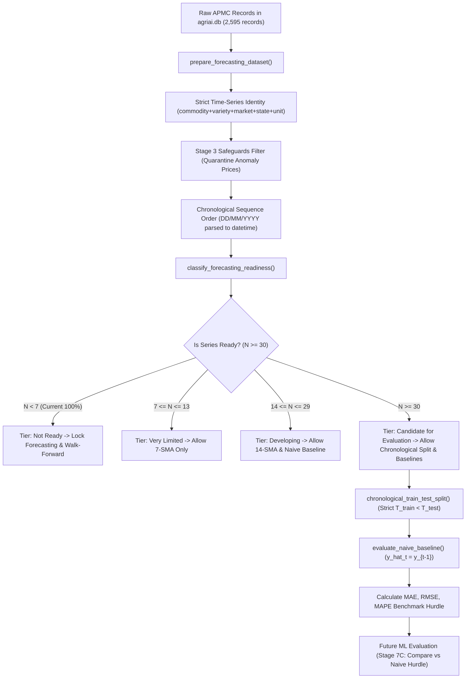

# AgriAI – Feature 5 Stage 7B: Mandi Forecasting Infrastructure & Readiness Gate

**Document:** `backend/FORECASTING_INFRASTRUCTURE.md`  
**Stage:** Feature 5 – Stage 7B  
**Target Environment:** Local Offline-First Farming Intelligence (`D:\AgriAI`)  
**Status:** **OPERATIONAL & AUDITED** (Readiness gate active; zero ML models trained; zero synthetic records inserted)

---

## 1. Architectural Overview

The Stage 7B Forecasting Infrastructure provides a robust, principled foundation for future AI-based agricultural price forecasting. 

In Stage 7A, our comprehensive empirical audit discovered that the database (`backend/data/agriai.db`) contains **2,595 genuine government records** across **1,471 APMC mandis**, but only spans **2 arrival dates** (`18/11/2026` and `19/11/2026`). Every single commodity-market time series currently has only **1 valid observation ($N = 1$)**.

Because predictive machine learning and autoregressive modeling strictly require longitudinal time series data, **Stage 7B establishes an automated "Readiness Gate" and data preparation infrastructure without training any premature machine learning models**.



---

## 2. Core Forecasting Readiness Taxonomy

The infrastructure enforces five engineering sample-size tiers based on genuine empirical observation count ($N$):

| Tier Key | Label | Observation Count ($N$) | Evaluation Allowed? | ML Training Permitted? | Engineering Rationale & Allowed Actions |
| :--- | :--- | :---: | :---: | :---: | :--- |
| `not_ready` | **Not Ready** | **0 – 6** | ❌ No | ❌ No | **Current state of 100% of series (2,595 / 2,595).** Single-day snapshot. Insufficient for moving averages, direction, or forecasting. |
| `very_limited` | **Very Limited** | **7 – 13** | ❌ No | ❌ No | Enables 7-day Simple Moving Average (7-SMA) and day-over-day price direction. Insufficient for predictive models. |
| `developing` | **Developing** | **14 – 29** | ⚠️ Naive Only | ❌ No | Developing baseline. Eligible for 14-SMA, Exponential Smoothing, and preliminary Naive Persistence walk-forward testing. |
| `candidate_for_evaluation` | **Candidate for Evaluation** | **30 – 59** | ✅ Yes | ⚠️ Pilot Baseline | Candidate for statistical time-series benchmarking (ARIMA, Naive Walk-Forward). Preliminary threshold only; does not guarantee accuracy. |
| `stronger_candidate` | **Stronger Candidate** | **60+** | ✅ Yes | ✅ Controlled Pilot | Stronger candidate for multi-feature machine learning evaluation using strictly causal lag features ($P_{t-1}, P_{t-7}$, rolling statistics). |

> [!IMPORTANT]
> **Engineering Threshold Disclaimer:**  
> These sample-size thresholds represent minimum empirical requirements for statistical validity, not proof or guarantees of model accuracy or financial profitability.

---

## 3. Data Preparation Pipeline (`backend/mandi_forecasting.py`)

The data preparation engine (`prepare_forecasting_dataset`) strictly adheres to data integrity principles:

1. **Strict Time-Series Identity:**
   Every series is strictly isolated by:
   $$\text{Series Key} = (\text{Commodity}, \text{Variety}, \text{Market}, \text{State}, \text{Unit})$$
   - Never combines Onion with Onion Green.
   - Never combines Cotton with Cotton Seed.
   - Never combines Wheat with Wheat Atta.
   - Never merges distinct varieties (e.g. Local vs Hybrid) or units (e.g. Rs/Quintal vs Rs/Kg).
2. **Chronological Sorting:**
   Observations are parsed into Python `datetime` objects and sorted strictly ascending by date ($t_0 \le t_1 \le t_2 \dots$).
3. **Stage 3 Quality Safeguards Integration:**
   Every price is evaluated against `evaluate_price_quality` from `backend/mandi_quality.py`.
   - Outliers and clerical decimal errors (e.g., Patti APMC Tomato ₹0.01, Rania APMC Onion ₹0.12) are quarantined into `excluded_observations` with documented reasons.
   - Zero deletion or mutation of underlying government records.
4. **Transparent Provenance Attribution:**
   Identifies whether each observation originated from `official_live` (authenticated live data.gov.in Agmarknet API) or `official_agmarknet_baseline` (DMI Agmarknet baseline).
5. **No Synthetic Data:**
   Zero synthetic dates, interpolated prices, or fake records are ever generated.

---

## 4. Chronological Validation & Leakage Prevention

Standard tabular machine learning functions (such as `train_test_split(shuffle=True)`) are **strictly prohibited** in AgriAI time-series modeling.

### Why Random Shuffling is Inappropriate for Time-Series
1. **Temporal Lookahead Bias (Data Leakage):** Shuffling leaks future price signals into the training set, allowing a model to predict past prices using future information. This results in artificially inflated test scores ($R^2 > 0.95$) that fail disastrously in live production.
2. **Autocorrelation Violation:** Daily agricultural wholesale prices are heavily autocorrelated ($\text{Corr}(P_t, P_{t-1}) \approx 0.85\text{--}0.95$). Random splitting places $P_t$ in train and $P_{t-1}$ in test, violating sample independence.

### The Chronological Split Utility (`chronological_train_test_split`)
- **Protocol:** Enforces strict chronological ordering: earlier observations belong to training, later observations to testing.
- **Minimum Training Size:** Requires at least 14 training observations and at least 1 test observation.
- **Formal Leakage Verification:** Verifies programmatically that:
  $$\max(T_{\text{train}}) \le \min(T_{\text{test}})$$
  Returning `leakage_check_passed: True` only when this condition is verified.

---

## 5. Naive Forecasting Baseline Engine

The Naive Persistence Model is defined as:

$$\hat{y}_{t} = y_{t-1} \quad (\text{Tomorrow's Predicted Price} = \text{Today's Latest Observed Price})$$

### Implementation Details (`evaluate_naive_baseline`)
- **Walk-Forward Evaluation:** Walks forward through time step-by-step ($t_1 \to t_2 \to t_3 \dots$).
- **Residual Error:** $e_t = y_t - \hat{y}_t = y_t - y_{t-1}$.
- **Metrics Calculated:**
  - **MAE (Mean Absolute Error):** $\text{MAE} = \frac{1}{k} \sum |e_t|$ (in ₹/Quintal).
  - **RMSE (Root Mean Squared Error):** $\text{RMSE} = \sqrt{\frac{1}{k} \sum e_t^2}$ (penalizes large swings).
  - **MAPE (Mean Absolute Percentage Error):** $\text{MAPE} = \frac{100\%}{k} \sum \left|\frac{e_t}{y_t}\right|$ (scale-independent percentage).
- **The Hurdle Rule:**  
  Before any future ML model (Random Forest, XGBoost, or ARIMA) is deployed, it **MUST beat the Naive Baseline's MAE and RMSE**. If an ML model fails to beat this simple baseline, it is discarded.

---

## 6. REST API Endpoints in `backend/app.py`

Three read-only endpoints provide full transparency into forecasting readiness and data preparation:

### 1. `GET /mandi/forecast/readiness`
System-wide aggregate readiness audit across all database time series.
- **Sample Response:**
```json
{
  "status": "success",
  "forecast_readiness": {
    "total_eligible_time_series": 2595,
    "overall_forecasting_readiness": "Not Ready",
    "is_ml_training_permitted": false,
    "readiness_distribution": {
      "not_ready": { "count": 2595, "pct": 100.0, "label": "Not Ready (0–6 obs)" },
      "very_limited": { "count": 0, "pct": 0.0, "label": "Very Limited (7–13 obs)" },
      "developing": { "count": 0, "pct": 0.0, "label": "Developing (14–29 obs)" },
      "candidate_for_evaluation": { "count": 0, "pct": 0.0, "label": "Candidate for Evaluation (30–59 obs)" },
      "stronger_candidate": { "count": 0, "pct": 0.0, "label": "Stronger Candidate (60+ obs)" }
    },
    "priority_benchmark_mandis": [ ... 10 national benchmark markets ... ],
    "system_verdict": "100% of historical mandi time series currently reside in the 'Not Ready' tier..."
  }
}
```

### 2. `GET /mandi/forecast/series`
Prepares a clean, validated time-series dataset for a specific commodity and APMC market.
- **Parameters:** `commodity` (required), `market` (required), `state` (optional), `variety` (optional), `unit` (optional).
- **Returns:** Chronologically sorted observations, valid observation count, excluded suspicious observations count, readiness tier, and provenance attribution.

### 3. `GET /mandi/forecast/baseline`
Evaluates the Naive Persistence Baseline model on a specific time series.
- **Parameters:** `commodity` (required), `market` (required), `state` (optional), `variety` (optional), `unit` (optional).
- **Returns:** Walk-forward evaluation metrics (MAE, RMSE, MAPE) when $N \ge 2$, or transparent `insufficient_data` status when $N < 2$.

---

## 7. Current Limitations & Conditions Required Before ML Training

### Current Limitations
1. **Single-Observation Horizon:** Every individual time series currently has $N = 1$ observation.
2. **Calendar Coverage:** Data is currently limited to two arrival dates (`18/11/2026` and `19/11/2026`).
3. **No Intraday or Futures Feeds:** APMC data reflects daily wholesale terminal arrivals only.

### Conditions Required Before ML Training (Stage 7C)
Machine learning model training (Random Forest / LightGBM / ARIMA) may ONLY commence when:
1. **Sample Size:** At least one priority benchmark mandi accumulates $\ge 30$ genuine daily observations via the Stage 4 automated collection pipeline (`backend/mandi_scheduler.py`).
2. **Continuity:** Calendar gaps between consecutive observations do not exceed 7 days for at least 80% of the sample.
3. **Strict Causal Features:** All engineered features must use strictly backward-looking lags ($P_{t-1}, P_{t-2}, P_{t-7}$, rolling 7-day mean/std).
4. **Validation:** Models must be backtested strictly using walk-forward chronological validation and must achieve an MAE lower than the Naive Persistence baseline.
5. **No Profit Guarantees:** Predictions must always be accompanied by uncertainty bounds and farmer risk disclaimers.

---

*Document generated under AgriAI Engineering Standards. All 2,595 genuine government database records preserved.*
