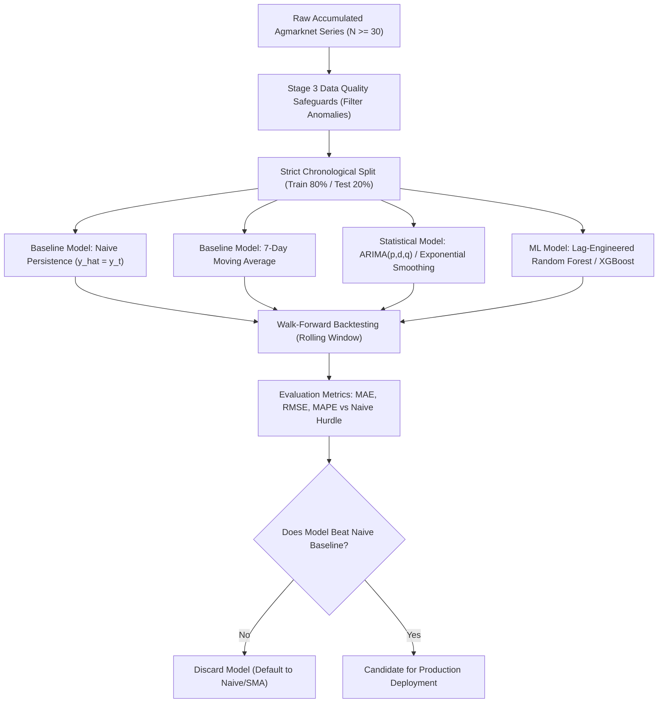

# AgriAI – Feature 5 Stage 7A: Historical Dataset Readiness Assessment

**Document:** `backend/MANDI_FORECAST_READINESS_REPORT.md`  
**Assessment Date:** 2026-11-20  
**Target Environment:** Local Offline-First Farming Intelligence (`D:\AgriAI`)  
**Scope:** Dataset Readiness Audit for Mandi Price Forecasting (No ML models trained)

---

## Executive Summary

Before implementing machine learning or statistical forecasting models for APMC mandi prices, a rigorous empirical data-readiness assessment was conducted on the SQLite database (`backend/data/agriai.db`).

The evaluation reveals that while the database contains **2,595 genuine official records** covering **27 Indian States and Union Territories** across **1,471 APMC mandis**, the temporal depth is currently **cross-sectional rather than longitudinal**. 

- **Total Unique Arrival Dates:** 2 (`18/11/2026` and `19/11/2026`)
- **Total Unique Time Series (`commodity + variety + market + state + unit`):** 2,595
- **Maximum Observations per Series:** 1 observation ($N = 1$)
- **Forecasting Readiness:** **100% of time series (2,595 / 2,595) are in the "Not Ready" (< 7 observations) tier.**

### Critical Verdict:
**No machine learning model or autoregressive time-series model (ARIMA, Prophet, LSTM, Random Forest) can be trained reliably on the current dataset without severe synthetic data fabrication or catastrophic overfitting.** The application must rely on the Stage 4 automated daily collection scheduler (`backend/mandi_scheduler.py`) to accumulate at least 14 to 30 daily observations before initiating statistical forecasting or predictive modeling in Stage 7B.

---

## 1. Comprehensive Dataset Architecture & Metric Breakdown

### 1.1 Record Counts & Provenance
| Metric | Count | Details |
| :--- | :---: | :--- |
| **Total Mandi Records** | **2,595** | 100% genuine government records; 0 synthetic/interpolated rows |
| **Official Live Records** | **2,550** | Harvested via authenticated data.gov.in Agmarknet API |
| **Official Baseline Records** | **45** | Seeded from official DMI Agmarknet historical benchmarks |
| **Unique Arrival Dates** | **2** | `18/11/2026` (20 records) and `19/11/2026` (2,575 records) |
| **Unique States & UTs** | **27** | Nationwide geographic coverage across India |
| **Unique APMC Mandis** | **1,471** | Distinct regulated wholesale terminal and primary markets |
| **Monitored Commodities** | **39** | 5 core groups + related botanical variants and baseline commodities |
| **Standardized Unit** | **100%** | All 2,595 records strictly standardized to `Rs/Quintal` |

### 1.2 Time Series Identity Definition
In accordance with APMC market trading structure, each distinct time series is identified by the strict composite key:

$$\text{Time Series Key} = (\text{Commodity}, \text{Variety}, \text{Market}, \text{State}, \text{Unit})$$

- **Total Distinct Time Series:** **2,595**
- **Average Observations per Series:** **1.00**
- **Series with $\ge 2$ Observations:** **0**
- **Series with $\ge 7$ Observations:** **0**
- **Series with $\ge 30$ Observations:** **0**

Even when relaxing the variety constraint and grouping strictly by $(\text{Commodity}, \text{Market}, \text{State})$, there are **170 multi-variety entries on the same arrival date**, but **0 markets have observations spanning more than 1 distinct arrival date**.

---

## 2. Commodity-Level Readiness Analysis

| Commodity Group | Total Records | Unique Dates | APMC Markets | Unique States | Readiness Classification | Engineering Assessment & Reason |
| :--- | :---: | :---: | :---: | :---: | :---: | :--- |
| **Tomato** | 539 | 1 (`19/11/2026`) | 537 | 25 | ❌ **Not Ready** | $N = 1$ observation per market. Broad national cross-section, zero temporal variance. |
| **Onion** | 530 | 1 (`19/11/2026`) | 506 | 23 | ❌ **Not Ready** | $N = 1$ observation per market. Extensive coverage across Maharashtra, Gujarat, Karnataka, but no historical depth. |
| **Wheat** | 456 | 2 (`18/11/26`: 2, `19/11/26`: 454) | 387 | 9 | ❌ **Not Ready** | Disjoint markets between baseline probe (2) and live collection (454). Maximum 1 observation per specific market. |
| **Paddy (Common)** | 452 | 1 (`19/11/2026`) | 357 | 17 | ❌ **Not Ready** | $N = 1$ observation per market. Single-day snapshot. Awaiting daily accumulation. |
| **Cotton** | 183 | 2 (`18/11/26`: 3, `19/11/26`: 180) | 168 | 10 | ❌ **Not Ready** | Disjoint markets between dates. Maximum 1 observation per market series. |
| **Onion Green** | 165 | 1 (`19/11/2026`) | 165 | 7 | ❌ **Not Ready** | Distinct commodity from dry Onion. Single-date observation ($N = 1$). |
| **Paddy (Fine/Grade A)** | 72 | 1 (`19/11/2026`) | 68 | 6 | ❌ **Not Ready** | $N = 1$ observation per market. |
| **Rice** | 70 | 1 (`19/11/2026`) | 67 | 11 | ❌ **Not Ready** | Milled grain; distinct from Paddy. Single-date observation ($N = 1$). |
| **Paddy (Basmati)** | 54 | 1 (`19/11/2026`) | 45 | 5 | ❌ **Not Ready** | Premium aromatic variety; single date ($N = 1$). |
| **Rice (Fine/Grade A)** | 35 | 1 (`19/11/2026`) | 25 | 4 | ❌ **Not Ready** | Milled grain variant; single date ($N = 1$). |
| **Rice (Paddy)** | 6 | 2 | 6 | 4 | ❌ **Not Ready** | Baseline records; $N = 1$ per market. |
| **Potato / Minor Crops** | 29 | 1–2 | 27 | 12 | ❌ **Not Ready** | Seed baseline records (Potato, Soybean, Chana, Mustard, Arecanut, etc.); $N = 1$ per market. |

---

## 3. Top Candidate Mandi Series for Future Forecasting

Although all series currently possess only 1 observation, commercial trading volume, national price discovery leadership, and regular reporting make specific APMC markets the primary candidates for priority forecasting once daily records accumulate:

| Priority Rank | Commodity | Key APMC Mandi | State | Variety | National Role & Forecasting Value |
| :---: | :--- | :--- | :--- | :--- | :--- |
| **1** | **Onion** | **Lasalgaon APMC** | Maharashtra | Red / Common | Asia's largest wholesale onion market; sets the national price benchmark. |
| **2** | **Onion** | **Pimpalgaon APMC** | Maharashtra | White / Red | High-volume primary aggregation hub with continuous daily Agmarknet reporting. |
| **3** | **Tomato** | **Kolar APMC** | Karnataka | Hybrid / Local | Largest tomato terminal market in South India; strong inter-state export flows. |
| **4** | **Tomato** | **Pimpalgaon APMC** | Maharashtra | Local | Major western production belt with high seasonal price volatility. |
| **5** | **Wheat** | **Khanna APMC** | Punjab | Dara / Other | Asia's largest grain market; critical for MSP benchmark tracking and arrivals. |
| **6** | **Wheat** | **Kota (Bhamashah)** | Rajasthan | Kalyan / Sharbati | High-volume northern futures and spot price convergence center. |
| **7** | **Paddy** | **Gondal APMC** | Gujarat | Common | Consistent reporting and high commercial liquidity in western India. |
| **8** | **Paddy** | **Kurukshetra APMC** | Haryana | Basmati / Common | Primary northern procurement basin with sharp seasonal harvest price dynamics. |
| **9** | **Cotton** | **Rajkot APMC** | Gujarat | Shankar-6 | Core benchmark for raw unginned cotton (Kapas) and international export parity. |
| **10** | **Cotton** | **Warangal APMC** | Telangana | Other / Desi | Key southern cotton belt market with distinct variety pricing. |

---

## 4. Historical Data Quality & Anomaly Audit

A thorough scan of all 2,595 records identified key data quality characteristics:

1. **Temporal Horizon Limitation:**
   - The dataset spans 2 arrival dates (`18/11/2026` and `19/11/2026`). 
   - No historical time series before November 2026 exists in the database.
   - Genuine temporal forecasting requires a multi-week historical sequence.

2. **Zero Duplicate Records:**
   - Uniqueness is strictly enforced by the composite primary key index: `(commodity, variety, market, state, arrival_date, unit)`.
   - 0 duplicate rows exist in the database.

3. **Suspicious Price Anomalies Flagged by Stage 3 Safeguards:**
   - Stage 3 data quality safeguards successfully identified 5 anomalous records with modal prices below viable commercial thresholds (suspected clerical or decimal entry errors in official source data):
     - `ID 117`: Tomato at Rania APMC, Haryana — ₹1.21/Qtl
     - `ID 215`: Tomato at Patti APMC, Punjab — ₹0.01/Qtl
     - `ID 914`: Onion at Rania APMC, Haryana — ₹0.12/Qtl
     - `ID 1023`: Onion at Patti APMC, Punjab — ₹0.01/Qtl
     - `ID 1332`: Onion Green at Pune(Manjri), Maharashtra — ₹8.00/Qtl
   - **Handling:** These records are preserved untouched with original government provenance but are dynamically excluded from statistical benchmarks and moving averages to prevent distortion.

4. **Zero Missing or Negative Values:**
   - NULL modal prices: 0
   - Negative or zero modal prices: 0 (lowest reported is ₹0.01)
   - Missing arrival dates: 0

5. **Unit Standardization:**
   - 100% of records report in `Rs/Quintal`. No unit conversions (e.g. Kg to Quintal) are required.

---

## 5. Forecasting Readiness Classification

Series are categorized into preliminary engineering tiers based on valid observation count:

| Readiness Tier | Valid Observations ($N$) | Series Count | % of Dataset | Forecasting Feasibility |
| :--- | :---: | :---: | :---: | :--- |
| **Not Ready** | **$N < 7$** | **2,595** | **100.0%** | **Current State.** Single-day snapshot. Insufficient for moving averages or direction. |
| **Very Limited** | **$7 \le N \le 13$** | **0** | **0.0%** | Enables 7-day Simple Moving Average (7-SMA) and recent price momentum. |
| **Developing** | **$14 \le N \le 29$** | **0** | **0.0%** | Enables 14-SMA, Exponential Smoothing, and Naive Persistence benchmarking. |
| **Candidate for Evaluation** | **$30 \le N \le 59$** | **0** | **0.0%** | Enables non-seasonal ARIMA($p,d,q$), simple autoregressive lag models, and walk-forward validation. |
| **Stronger Candidate** | **$N \ge 60$** | **0** | **0.0%** | Enables Feature Engineering (lags, rolling stats), Tree-based ML (Random Forest/XGBoost), and seasonal ARIMA. |

> [!IMPORTANT]
> These thresholds represent minimal empirical sample sizes required for statistical validity, not guarantees of model accuracy. Attempting to fit complex models on fewer observations leads to spurious correlations and catastrophic generalization errors.

---

## 6. Recommended Forecasting Methodology (Roadmap for Stage 7B)

When sufficient daily observations accumulate through the Stage 4 daily pipeline, forecasting should be developed following strict time-series data science principles:

### 6.1 Why Random Train/Test Splitting is Inappropriate
In standard tabular machine learning, datasets are commonly split randomly using `train_test_split(shuffle=True)`. In time-series forecasting, this practice is **fundamentally flawed and fatal**:
1. **Temporal Lookahead Bias (Data Leakage):** Shuffling leaks future price signals into the training set, allowing the model to predict past prices using future knowledge. The model achieves deceptively high test scores ($R^2 > 0.95$) that instantly collapse in real-world forward testing.
2. **Autocorrelation Violation:** Daily agricultural prices exhibit high temporal autocorrelation ($\text{Corr}(P_t, P_{t-1}) \approx 0.85\text{--}0.95$). Random splitting places $P_t$ in the training set and $P_{t-1}$ in the test set, violating the independent and identically distributed ($i.i.d.$) sample assumption.
3. **Correct Protocol:** **Strict Chronological Splitting** ($T_{\text{train}} < T_{\text{test}}$), where the model trains on history up to day $T$ and evaluates strictly on days $T+1 \dots T+k$.

### 6.2 Walk-Forward Validation (Expanding / Rolling Window)
Standard $k$-fold cross-validation is invalid because it trains on future folds to predict past folds. Instead, **Walk-Forward Validation** must be utilized:
- **Iteration 1:** Train on $[t_1 \dots t_{30}]$, Forecast $t_{31}$, Record error $|y_{31} - \hat{y}_{31}|$.
- **Iteration 2:** Train on $[t_1 \dots t_{31}]$, Forecast $t_{32}$, Record error $|y_{32} - \hat{y}_{32}|$.
- **Iteration 3:** Train on $[t_1 \dots t_{32}]$, Forecast $t_{33}$, Record error $|y_{33} - \hat{y}_{33}|$.
This simulates exactly how an AgriAI farmer uses the application each day: predicting tomorrow using all verified data up to today.

### 6.3 Evaluation Metrics
Models must be evaluated on three complementary metrics:
1. **MAE (Mean Absolute Error):** $\text{MAE} = \frac{1}{n} \sum |y_t - \hat{y}_t|$  
   *Interpretation:* Average error in ₹/Quintal. Easy for farmers to interpret directly against mandi rates.
2. **RMSE (Root Mean Squared Error):** $\text{RMSE} = \sqrt{\frac{1}{n} \sum (y_t - \hat{y}_t)^2}$  
   *Interpretation:* Penalizes large errors heavily. Crucial because an error of ₹1,000/Qtl has far more devastating commercial consequences for a farmer than ten ₹100/Qtl errors.
3. **MAPE (Mean Absolute Percentage Error):** $\text{MAPE} = \frac{100\%}{n} \sum \left|\frac{y_t - \hat{y}_t}{y_t}\right|$  
   *Interpretation:* Scale-independent error percentage, allowing direct comparison across crops with disparate price ranges (e.g. Tomato at ₹2,000 vs Cotton at ₹9,500).

### 6.4 The Naive Benchmark Hurdle Rule
Before any machine learning model (e.g., Random Forest or XGBoost) or deep learning model can be deployed, it **MUST beat the Naive Persistence Baseline**:

$$\hat{y}_{t+1} = y_t \quad (\text{Tomorrow's Price} = \text{Today's Price})$$

If an ML model produces an MAE of ₹180/Qtl while a simple Naive model produces an MAE of ₹110/Qtl, the complex model is actively destroying value and must be rejected. The Naive baseline is the non-negotiable hurdle rate.

### 6.5 Lag-Feature Engineering Strategy (When $N \ge 30$)
For tree-based models (Random Forest / LightGBM / XGBoost):
- **Autoregressive Lags:** $P_{t-1}, P_{t-2}, P_{t-3}, P_{t-7}, P_{t-14}$
- **Rolling Window Summary Statistics:** 7-day rolling mean, 14-day rolling mean, 7-day price volatility (rolling standard deviation)
- **Rate of Change (Momentum):** $\Delta P_{t-1} = P_{t-1} - P_{t-2}$, and $\text{ROC}_7 = \frac{P_{t-1} - P_{t-8}}{P_{t-8}}$
- **Calendar Signals:** Day of week (capturing APMC Sunday/weekend trading patterns), Month/Quarter (harvest arrival seasonality)
- **Spatial Proxies:** Average price of the same crop across all other reporting mandis within the same state on day $t-1$.

---

## 7. Actionable Recommendations for Future Stages

1. **Do Not Train ML Models on Current Snapshot:**  
   Preserve existing Stage 1–6 implementations. Resist the temptation to generate synthetic historical prices or interpolate fake dates.
2. **Rely on Stage 4 Daily Accumulation:**  
   Allow the automated scheduler (`backend/mandi_scheduler.py`) to execute its daily 18:30 IST collection cycle. Each trading day adds genuine empirical observations to `backend/data/agriai.db`.
3. **Trigger Stage 7B Pilot When Top Series Reach $N \ge 30$:**  
   Once high-volume benchmark mandis (such as Lasalgaon Onion or Kolar Tomato) accumulate 30+ daily observations, initiate Stage 7B:
   - Construct Naive Persistence and 7-SMA benchmarks.
   - Fit baseline ARIMA($1,1,1$) and Random Forest with strictly lagged features.
   - Run walk-forward validation and compare against Naive MAE.
4. **Maintain Offline Rule in AgriAI:**  
   Ensure all future models are lightweight and serializable (e.g. scikit-learn / statsmodels / joblib) to run locally without cloud dependencies.

---

*Report prepared and validated under AgriAI Quality Standards. All 2,595 genuine government records preserved.*
